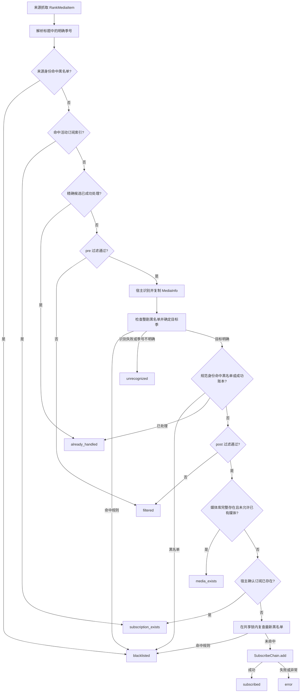

# 自动订阅助手 v3 架构

本插件后续仅维护、测试和发布 MoviePilot v3 版本。源码位于 `plugins.v3/automaticsubscriptionassistant/`，安装后由宿主加载到 `app/plugins/automaticsubscriptionassistant/`。本文以该目录下 3.2.0 的实现为依据；具体发布版本以 Release 为准。

## 模块职责

| 模块 | 职责 |
| --- | --- |
| `__init__.py` | 装载配置，注册来源定时任务、插件 API、数据库模型、侧栏与仪表盘入口 |
| `core/provider.py`、`core/registry.py` | 定义 `RankProvider`、运行上下文 `ProviderContext`，注册并创建来源 |
| `providers/*.py` | 抓取并解析五类来源，产出 `RankMediaItem`，声明配置与过滤字段 |
| `core/config.py` | 类型转换、全局与来源配置访问、按 `ProviderSpec` 生成默认值 |
| `core/filters.py` | 组合 pre/post 过滤链，返回接受或拒绝的原因 |
| `core/dedup.py` | 从宿主活动订阅建立 `SubscribedIndex`，按身份、类型、季号和剧集组快速去重 |
| `core/executor.py` | 单条候选的黑名单检查、识别、去重、订阅与历史记录 |
| `core/runner.py` | 单来源抓取与逐条执行、退出信号、统计、异常兜底和历史修剪 |
| `core/history.py`、`core/tables.py` | 展示历史、独立成功账本、SQL 查询与写入 |
| `core/migration.py` | 归档并迁移旧 KV 历史，保留失败源以便重试 |
| `core/blacklist.py` | 独立黑名单 KV 存储、匹配、管理 API、先保存规则再退订 |
| `core/subscribes.py` | 管理本插件用户名对应的订阅，复核归属后退订或暂停/恢复 |
| `core/models.py`、`core/i18n.py` | 候选、结果、配置描述与历史模型，来源名称和字段文本本地化 |

来源只负责抓取与解析；识别、订阅和历史统一由 executor 处理。provider 可通过上下文中的 `get_data/save_data` 保存缓存，黑名单也使用这组宿主 KV 端口。

## 执行流程

每个启用且 cron 有效的来源注册独立任务。`POST /run` 则安排指定来源在约 3 秒后执行。

所有结果参与本轮统计。普通处理分支会写入或合并历史；`already_handled` 不写新历史，活动索引短路也会避免重复写已处理记录。单条异常不会中断整个来源。

`get_no_exists_info()` 返回 `True` 表示媒体库完整存在，只有 `exist_ok=False` 时才因此跳过订阅。完整存在的判定仍由宿主负责。

## 媒体身份与季号

候选优先携带宿主通用身份 `media_source + media_id`。旧 `tmdb_id/douban_id/bangumi_id` 字段作为兼容入口保留；新增来源通过通用身份接入。识别后从 `MediaInfo` 解析最终主身份，再交给 `SubscribeChain`，不会直接用原始豆瓣 ID 创建另一个来源的订阅。

明确季号在预去重之前从标题或候选字段解析，特别篇 `0` 不被当作空值。未知季不会通过“任意已订阅季”匹配；识别后仍无法确定目标季且存在多个可能季时，保留为 `unrecognized`。只有一个正季可用时才允许推导该季。

规范键区分电影与剧集，并在适用时包含季号与剧集组。识别返回的媒体对象可能来自宿主共享缓存，executor 深拷贝后再设置目标季与剧集组。未知季候选不永久绑定到第一次识别出的季。

## 状态与存储

`SubscribeStatus` 当前有八种结果：

| 值 | 含义 | 写入成功账本 |
| --- | --- | --- |
| `subscribed` | 创建订阅成功 | 是 |
| `media_exists` | 媒体库完整存在且未允许已有媒体 | 是 |
| `subscription_exists` | 活动索引或宿主确认订阅已存在 | 是 |
| `already_handled` | 精确候选或规范身份已成功处理 | 沿用已有状态 |
| `blacklisted` | 用户主动忽略 | 否 |
| `filtered` | 来源规则过滤 | 否 |
| `unrecognized` | 未识别到媒体或未确定目标季 | 否 |
| `error` | 处理或订阅失败 | 否 |

`subscribe_history` 保存按身份合并的展示记录，包括来源候选快照 `source_item` 和精确候选键 `candidate_key`。`subscribe_handled` 独立保存规范身份及精确候选别名。成功记录不被后续过滤、错误或忽略结果降级。

历史写入即时提交，查询、筛选和分页由 SQL 完成。`history_keep` 只修剪展示历史，成功账本保留；显式删除历史或清空历史才解除对应成功状态与别名。重新识别优先恢复来源快照，先保存新结果，再在适用时移除旧身份记录。

表结构初始化使用 engine 弱引用集合与共享锁，兼容旧表候选列补齐。KV 历史迁移先归档再写库；备份失败保留源，部分失败留待重试，重复迁移不覆盖较新的数据库记录。

## 黑名单

规则单独保存在宿主插件 KV 的 `subscription_blacklist`，与历史表和成功账本分开。清空历史、修剪展示记录、删除订阅或重启插件不会移除规则。

- 电影按身份忽略；剧集可指定季或全部季。类型未知且只有 TMDB ID 时不在识别前直接拦截，避免电影与剧集 ID 空间重叠。
- 从历史添加时保留原始来源与规范身份别名。整剧 TMDB 身份可覆盖不同季的豆瓣 subject ID。
- 豆瓣/Bangumi 的全部季规则若缺少整剧身份，会调用宿主识别补充；无法确认时返回失败，提示改用 TMDB ID、名称规则或指定季。
- 无 ID 规则按完整名称、类型与可选年份匹配；名称忽略大小写和连续空白。ID 规则不会单凭同名回退匹配。
- 识别前、识别后与创建订阅前检查规则。规则写入和最终“检查并添加订阅”共用进程内 `RLock`，防止同一进程中的在途候选绕过新规则。
- `POST /subscribes/block` 先保存规则再退订。保存失败不退订；退订失败保留规则，并返回失败 ID 和原因。

移除规则后，下次运行恢复正常评估；成功历史仍参与去重，不会因移除黑名单立即创建订阅。详细用户操作见[黑名单说明](../../../docs/automatic-subscription-assistant-blacklist.md)。

## 来源差异

| 来源 | 默认 cron | 当前行为 |
| --- | --- | --- |
| `douban` | `0 8 * * *` | RSSHub 内置榜单或自定义 RSS，提取豆瓣身份，标题中的明确季号交给 executor |
| `maoyan` | `0 9 * * *` | 电影票房与平台×类型网播热度；网络电影已移除；日期解析区分过去/未来，未知格式不猜年份 |
| `popular` | `5 1 * * *` | 读取宿主热门订阅统计，依赖订阅数据共享；电影/剧集配置独立，评分与人次在来源内过滤，去重保留季号 |
| `mikan` | `0 10 * * 1` | 季度新番，可补充 Bangumi ID；无 ID 时交给宿主按名称与年份识别 |
| `netflix` | `0 11 * * 3` | 全球榜与国家榜，TSV 或富元数据；去重保留季号，史上最热使用对应数据集 |

Netflix TSV 按 UTF-8 解码，以换行符分行，避免特殊字符误断行。缓存分模块内存与插件 KV 两层，仅缓存完整成功结果；抓取失败、空结果或富页缺项不作为长期成功缓存。连通性测试强制禁用缓存，只验证抓取，不进入订阅/历史管线。

缺少 cron 配置时使用来源默认值；后端显式空字符串不会注册任务。前端装载配置时会把空 cron 回填为来源默认值。保存配置会校验持久化结果，重新初始化插件并刷新宿主任务；空监听来源会被关闭。

## 前端、侧栏与 API

详情/配置界面提供历史、管理、黑名单、配置四个标签。侧栏项以 `self.plugin_name` 显示“自动订阅助手”，使用 `mdi-rss`，归入 `subscribe` 分组、要求 `subscribe` 权限，保留 `nav_key=blacklist`。宿主聚合已启用插件的侧栏项；插件总开关和至少一个来源需启用。

`AppPageBlacklist` 是独立联邦入口，透传属性到 `AppPage`；`AppPage` 复用 `Page` 并以黑名单为初始视图。`Page` 管理三类列表的共享分页和移动端行数。黑名单与历史复用 `MediaCard`、`FilterPanel`、`styles/mediaViews.css`，筛选草稿只有在应用后才生效。

所有插件路由声明见 `get_api()`；完整接口清单见[使用文档](../README.md#后端-api)。除 `DELETE /history` 为 `apikey` 外，其余均为 `bear`。批量管理须按 `ok_ids/failed_ids` 展示结果，不能只依据 `code=0` 清空全部选择。

## 仪表盘

`get_dashboard_meta()` 沿用 `overview` 键和“自动订阅助手 · 订阅概览”名称；`get_dashboard()` 返回 `cols=12/md=6`、默认 300 秒刷新和 Vue 模式空元素。空键兼容旧调用，未知组件键返回空。宿主的仪表盘设置负责组件启用与布局。

组件使用只读 `GET /dashboard` 汇总读取：复用 `/status` 的来源/运行状态和保留历史统计，再读取本插件用户名对应的当前订阅、暂停数量、独立黑名单规则数量，以及最多五条 `subscribed` 历史。存储读取失败返回业务错误，不用零值掩盖失败。

前端在零历史时仍显示指标和来源。图表使用当前保留历史，兼容旧状态及未知状态；不能把这些数量解释为终生执行次数。最近订阅标题保留季号、特别篇和剧集组。

数据请求完成后才安排下一次自动刷新，在途请求去重；宿主停用刷新、变更周期或组件卸载时清理计时器。卸载后的迟到响应不写入状态，手动刷新失败保留最近成功数据。组件只做读取与页面跳转，不提供运行来源或订阅写操作。

## 开发与验证

新增来源实现 `RankProvider.get_spec()/fetch()`，在 `providers/__init__.py` 注册；新增过滤器在 `core/filters.py` 声明并加入对应来源 schema。

v3 后端回归位于 `tests/plugins.v3/automaticsubscriptionassistant/tests/`，在插件仓根目录使用可导入 MoviePilot v3 宿主的环境执行 `python -m pytest tests/plugins.v3/automaticsubscriptionassistant/tests -q`。测试引导使用临时配置与数据库。

前端在 `frontend/` 执行 `npm test`、`npm run build`；行为测试运行实际组件脚本与 Vue 响应式逻辑，浏览器联调仍需真实宿主或明确标识的内存预览。前端入口与构建步骤见[前端说明](../frontend/README.md)。
