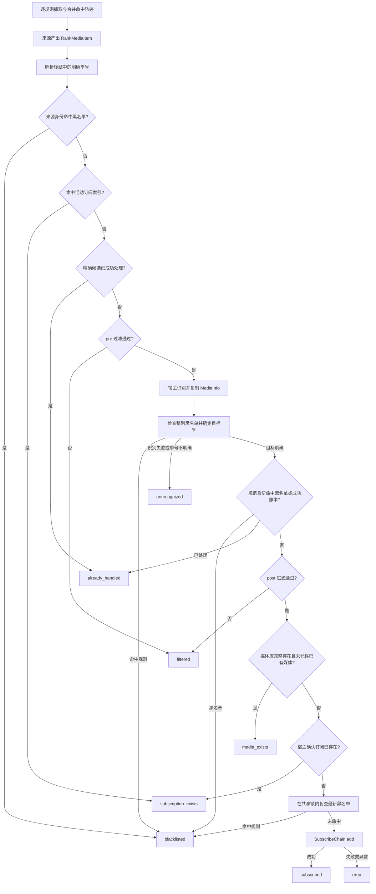

# 自动订阅助手 v3 架构

本插件后续仅维护、测试和发布 MoviePilot v3 版本。源码位于 `plugins.v3/automaticsubscriptionassistant/`，安装后由宿主加载到 `app/plugins/automaticsubscriptionassistant/`。本文以该目录当前源码为依据，对应插件 3.4.0；发行包以 Release 为准。

## 模块职责

| 模块 | 职责 |
| --- | --- |
| `__init__.py` | 装载配置，注册来源定时任务、插件 API、数据库模型、侧栏与仪表盘入口 |
| `core/provider.py`、`core/registry.py` | 定义 `RankProvider`、运行上下文 `ProviderContext`，注册并创建来源 |
| `providers/*.py` | 抓取并解析十类来源，产出 `RankMediaItem`，声明配置与过滤字段 |
| `core/rules.py`、`providers/rule_specs.py` | 独立规则契约、请求转换、候选合并与命中轨迹 |
| `core/config.py` | 类型转换、全局与来源配置访问、按 `ProviderSpec` 生成默认值 |
| `core/filters.py` | 组合 pre/post 过滤链，返回接受或拒绝的原因 |
| `core/dedup.py` | 从宿主活动订阅建立 `SubscribedIndex`，按身份、类型、季号和剧集组快速去重 |
| `core/executor.py` | 单条候选的黑名单检查、识别、去重、订阅与历史记录 |
| `core/runner.py` | 单来源抓取与逐条执行、退出信号、统计、异常兜底和历史修剪 |
| `db/models/`、`db/oper/` | 独立 ORM 表模型与使用调用方 Session 的 SQL 操作 |
| `database/` | Alembic 版本迁移、旧 KV 接管、数据库事务、备份与停机维护恢复 |
| `services/` | 历史事务重试、黑名单校验与匹配 |
| `api/` | 按领域拆分的 HTTP 端点与路由声明 |
| `core/subscribes.py` | 管理本插件用户名对应的订阅，复核归属后退订或暂停/恢复 |
| `providers/music_common.py`、`providers/music_catalogs.py` | 音乐候选投影及固定官方榜单目录 |
| `schemas/`、`core/i18n.py` | 独立业务数据契约、来源名称和字段文本本地化 |

来源只负责抓取与解析；识别、订阅和历史统一由 executor 处理。provider 可通过上下文中的 `get_data/save_data` 保存缓存，生产黑名单通过上下文注入 SQL 服务，KV 只用于旧数据接管和可重建缓存。

## 宿主 SDK 与兼容边界

插件优先使用宿主 `app.sdk` 中实际公开的稳定接口，不增加指向宿主私有实现的本地转导层。

| 能力 | 使用入口 |
| --- | --- |
| 插件基类、KV 与插件数据库句柄 | `app.sdk.plugin._PluginBase` 及其公开方法 |
| 配置、日志、事件与调度 | `app.sdk.config`、`app.sdk.logging`、`app.sdk.events`、`app.sdk.scheduler` |
| HTTP、页面解析 | `app.sdk.network`、`app.sdk.utilities` |
| 浏览器上下文 | `app.sdk.browser.launch_browser_context` |
| 媒体对象、标题解析、来源规范化与身份规则 | `app.sdk.media` |
| 插件自有表基类 | `app.sdk.database.plugin_declarative_base` |
| 当前订阅列表与单条订阅快照 | `app.sdk.queries.list_subscriptions/get_subscription` |

订阅预去重与管理列表通过查询 SDK 按 ID 升序读取所有页，不受默认单页数量限制；用户名在宿主查询端精确筛选。修改状态和取消订阅前仍重新读取快照校验归属。删除事件使用快照的 JSON 数据，不读取 ORM 表结构。

猫眼浏览器在导航或 Cookie 读取失败时降级为空 Cookie 请求，所有路径均关闭上下文；关闭失败只告警，保留已取得的 Cookie。轻量浏览器 SDK 不包含旧私有 `PlaywrightHelper.action` 的 FlareSolverr 预处理；依赖该预处理才能访问猫眼的环境需要宿主提供相应公开能力。

当前宿主 SDK 尚未覆盖以下接口，插件保留这些精确依赖：

- `app.chain.download.DownloadChain`：媒体库完整性检查。
- `app.chain.subscribe.SubscribeChain`：最终订阅查重和新增订阅。
- `app.db.oper.subscribe.SubscribeOper`：删除订阅与修改状态；读取已迁至查询 SDK。
- `app.adapters.external.server.MoviePilotServerHelper`：官方热门订阅统计及空结果诊断。

`MediaType/MediaSource/EventType`、`ConfigChangeEventData`、`Subscribe` 继续使用公开的 `app.schemas` 模型；当前 SDK 没有对应导出。不使用 `app.sdk._legacy` 私有兼容入口替代这些依赖。最低宿主版本为 MoviePilot **3.0.3**：已核对官方标签，3.0.0–3.0.2 尚无 `app.sdk.plugin` 入口，3.0.3 已导出 `_PluginBase`；查询、浏览器和媒体接口也已公开。该版本要求按官方源码入口核定，本地完整回归使用当前开发宿主。

`test_sdk_imports.py` 校验所有 SDK 导出真实存在，并限制剩余内部导入的文件、路径及符号。官方补齐接口后应同时更新实现和该检查。

## 执行流程

通知由 `providers.<provider_id>.notify` 独立控制，默认关闭；来源与调度区域提供开关。全局设置不再提供通知总开关，也不回退旧全局值。运行结束汇总一条通知；部分处理后抓取失败合并统计与错误，避免同时发送失败和成功。空结果同样通知，停止中的旧任务不发送结果；通知发送失败只记录日志。

每个启用且 cron 有效的来源注册独立任务。`POST /run` 则安排指定来源在约 3 秒后执行。

所有结果参与本轮统计。普通处理分支会写入或合并历史；`already_handled` 不写新历史，活动索引短路也会避免重复写已处理记录。单条异常不会中断整个来源。

`get_no_exists_info()` 返回 `True` 表示媒体库完整存在，只有 `exist_ok=False` 时才因此跳过订阅。完整存在的判定仍由宿主负责。

## 媒体身份与季号

候选优先携带宿主通用身份 `media_source + media_id`。旧 `tmdb_id/douban_id/bangumi_id` 字段作为兼容入口保留；新增来源通过通用身份接入。识别后从 `MediaInfo` 解析最终主身份，再交给 `SubscribeChain`，不会直接用原始豆瓣 ID 创建另一个来源的订阅。

明确季号在预去重之前从标题或候选字段解析，特别篇 `0` 不被当作空值。未知季不会通过“任意已订阅季”匹配；识别后仍无法确定目标季且存在多个可能季时，保留为 `unrecognized`。只有一个正季可用时才允许推导该季。

规范键区分电影与剧集，并在适用时包含季号与剧集组。识别返回的媒体对象可能来自宿主共享缓存，executor 深拷贝后再设置目标季与剧集组。未知季候选不永久绑定到第一次识别出的季。

## 状态与存储

`SubscribeStatus` 当前有八种结果：

| 值 | 含义 | 写入成功账本 |
| --- | --- | --- |
| `subscribed` | 创建订阅成功 | 是 |
| `media_exists` | 媒体库完整存在且未允许已有媒体 | 是 |
| `subscription_exists` | 活动索引或宿主确认订阅已存在 | 是 |
| `already_handled` | 精确候选或规范身份已成功处理 | 沿用已有状态 |
| `blacklisted` | 用户主动忽略 | 否 |
| `filtered` | 来源规则过滤 | 否 |
| `unrecognized` | 未识别到媒体或未确定目标季 | 否 |
| `error` | 处理或订阅失败 | 否 |

`subscribe_history` 保存按身份合并的展示记录，包括来源候选快照 `source_item` 和精确候选键 `candidate_key`。`subscribe_handled` 独立保存规范身份及精确候选别名。成功记录不被后续过滤、错误或忽略结果降级。

历史写入即时提交，查询、筛选和分页由 SQL 完成。`history_keep` 只修剪展示历史，成功账本保留；显式删除历史或清空历史才解除对应成功状态与别名。重新识别优先恢复来源快照，先保存新结果，再在适用时移除旧身份记录。

表结构由 `database/migrations/` 的 Alembic 版本树接管；初始化先备份、迁移并验证结构，再导入旧 KV。失败时不调度自动任务。事务内核对当前 revision，拒绝未知版本和自动降级。完整管理边界、清理语义与维护操作见[数据库生命周期](database.md)。

## 黑名单

规则按行保存在插件自有 SQL 表 `subscription_blacklist`，与历史及成功账本一并进入数据库快照。旧同名 KV 自动归档接管，SQL 检查点避免重试复活已删除规则。清空历史、修剪展示记录、删除订阅或重启插件不会移除规则。

- 电影按身份忽略；剧集可指定季或全部季。类型未知且只有 TMDB ID 时不在识别前直接拦截，避免电影与剧集 ID 空间重叠。
- 从历史添加时保留原始来源与规范身份别名。整剧 TMDB 身份可覆盖不同季的豆瓣 subject ID。
- 豆瓣/Bangumi 的全部季规则若缺少整剧身份，会调用宿主识别补充；无法确认时返回失败，提示改用 TMDB ID、名称规则或指定季。
- 无 ID 规则按完整名称、类型与可选年份匹配；名称忽略大小写和连续空白。ID 规则不会单凭同名回退匹配。
- 识别前、识别后与创建订阅前检查规则。规则写入和最终“检查并添加订阅”共用进程内 `RLock`，防止同一进程中的在途候选绕过新规则。
- `POST /subscribes/block` 先保存规则再退订。保存失败不退订；退订失败保留规则，并返回失败 ID 和原因。

移除规则后，下次运行恢复正常评估；成功历史仍参与去重，不会因移除黑名单立即创建订阅。详细用户操作见[黑名单说明](../../../docs/automatic-subscription-assistant-blacklist.md)。

## 来源差异

| 来源 | 默认 cron | 当前行为 |
| --- | --- | --- |
| `douban` | `0 8 * * *` | RSSHub 内置榜单或自定义 RSS，提取豆瓣身份，标题中的明确季号交给 executor |
| `maoyan` | `0 9 * * *` | 电影票房与平台×类型网播热度；网络电影已移除；日期解析区分过去/未来，未知格式不猜年份 |
| `popular` | `5 1 * * *` | 读取宿主热门订阅统计，依赖订阅数据共享；电影/剧集配置独立，评分与人次在来源内过滤，去重保留季号 |
| `mikan` | `0 10 * * 1` | 季度新番，可补充 Bangumi ID；无 ID 时交给宿主按名称与年份识别 |
| `netflix` | `0 11 * * 3` | 全球榜与国家榜，TSV 或富元数据；去重保留季号，史上最热使用对应数据集 |

Netflix TSV 按 UTF-8 解码，以换行符分行，避免特殊字符误断行。缓存分模块内存与插件 KV 两层，仅缓存完整成功结果；抓取失败、空结果或富页缺项不作为长期成功缓存。连通性测试强制禁用缓存，只验证抓取，不进入订阅/历史管线。

缺少 cron 配置时使用来源默认值；后端显式空字符串不会注册任务。前端装载配置时会把空 cron 回填为来源默认值。保存配置会校验持久化结果，重新初始化插件并刷新宿主任务；空监听来源会被关闭。

## 历史补充编辑

`core/supplement.py` 校验并串行处理显式手动请求，通过 `Subscribe` 模型和参数白名单限制输入。用户清空身份后不恢复旧 ID；剧集要求显式季号。用户名固定来自插件配置，状态、订阅 ID 和下载事实不可由请求覆盖。

手动调用 `SubscribeExecutor(manual=True)` 跳过推荐筛选及旧账本快速短路，重新执行识别、类型检查、黑名单、媒体库和宿主订阅查重；最终新增仍与黑名单变更使用同一把锁。成功写历史和账本，自动任务保持原来的持久去重规则；失败不撤销已有成功事实。返回处理状态与 `created`，前端不能把处理完成等同于新建成功。

## 前端、侧栏与 API

详情/配置界面提供历史、管理、黑名单、配置四个标签。侧栏项以 `self.plugin_name` 显示“自动订阅助手”，使用 `mdi-rss`，归入 `subscribe` 分组、要求 `admin` 权限，主入口为 `nav_key=main`。侧栏不显示配置标签与右上角关闭按钮。宿主聚合已启用插件的侧栏项；插件总开关和至少一个来源需启用。

`AppPage` 是侧栏主联邦入口；`AppPage` 复用 `Page` 并以订阅历史为初始视图。桌面侧栏固定页头、标签、统计与功能区，只让卡片列表滚动；`ProgressiveList` 观察列表底部并逐批加载，历史按每批 24 条请求后端，管理与黑名单逐批呈现前端筛选结果。切换筛选或刷新会重置加载范围，失败保留已加载内容并支持重试。详情弹窗与手机侧栏仍使用共享分页和移动端行数。黑名单与历史复用 `MediaCard`、`FilterPanel`、`styles/mediaViews.css`，筛选草稿只有在应用后才生效。

订阅管理单卡操作通过 `moviepilot:subscriptionManager` 宿主入口复用原生编辑/活动弹窗、媒体路由及管理 API。宿主以订阅 ID 重新读取记录，权限和归属由主程序校验；插件只处理保存后的刷新，不把媒体快照或用户名作为授权依据。旧宿主缺少入口时保留原有暂停/恢复及取消订阅流程，并提示新增原生功能需要升级前端。

所有插件路由声明见 `api/routes.py` 的 `get_api()`；完整接口清单见[使用文档](../README.md#后端-api)。除 `DELETE /history` 为 `apikey` 外，其余均为 `bear`。批量管理须按 `ok_ids/failed_ids` 展示结果，不能只依据 `code=0` 清空全部选择。

## 仪表盘

`get_dashboard_meta()` 沿用 `overview` 键和“自动订阅助手 · 订阅概览”名称；`get_dashboard()` 返回 `cols=12/md=6`、默认 300 秒刷新和 Vue 模式空元素。空键兼容旧调用，未知组件键返回空。宿主的仪表盘设置负责组件启用与布局。

组件使用只读 `GET /dashboard` 汇总读取：复用 `/status` 的来源/运行状态和保留历史统计，再读取本插件用户名对应的当前订阅、暂停数量、独立黑名单规则数量，以及最多五条 `subscribed` 历史。存储读取失败返回业务错误，不用零值掩盖失败。

前端在零历史时仍显示指标和来源。图表使用当前保留历史，兼容旧状态及未知状态；不能把这些数量解释为终生执行次数。最近订阅标题保留季号、特别篇和剧集组。

数据请求完成后才安排下一次自动刷新，在途请求去重；宿主停用刷新、变更周期或组件卸载时清理计时器。卸载后的迟到响应不写入状态，手动刷新失败保留最近成功数据。组件只做读取与页面跳转，不提供运行来源或订阅写操作。

## 开发与验证

新增来源实现 `RankProvider.get_spec()/fetch()`，在 `providers/__init__.py` 注册；新增过滤器在 `core/filters.py` 声明并加入对应来源 schema。

v3 后端回归位于 `tests/plugins.v3/automaticsubscriptionassistant/tests/`，在插件仓根目录使用可导入 MoviePilot v3 宿主的环境执行 `python -m pytest tests/plugins.v3/automaticsubscriptionassistant/tests -q`。测试引导使用临时配置与数据库。

前端在 `frontend/` 执行 `npm test`、`npm run build`；行为测试运行实际组件脚本与 Vue 响应式逻辑，浏览器联调仍需真实宿主或明确标识的内存预览。前端入口与构建步骤见[前端说明](../frontend/README.md)。

新增动画和音乐来源的查询、身份与匹配规则见[动画与音乐榜单](sources.md)。音乐元数据使用 `MetaMusic` / `MusicInfo`，使用同一订阅链但独立音乐身份空间，季号只用于剧集。

规则来源使用 `options.rules`，在任何请求前按 FieldSpec 校验，显式空列表停止运行；不通过旧平铺字段回退拼装规则。候选合并保留全部命中来源与规则，过滤按同一规则内 AND、跨规则 OR 执行。缓存对象先复制再补充轨迹，避免规则名称污染缓存。单规则失败保留其它结果并统一报告失败，停止时不落地已收集候选。历史命中轨迹以现有 JSON 字段保存，无需新增数据库版本；补充轨迹不会覆盖成功状态、首次归属及时间。

检测到旧平铺榜单/筛选配置且尚未保存新规则时，停止自动监听并要求重新设置；配置页显示空规则，防止把旧条件静默替换为默认规则。首次未配置的来源仍提供预设卡片。

全部十源只暴露 `rule-list`，苹果、猫眼及奈飞地区榜按单条规则转换请求参数。前端移除地区/平台矩阵，规则管理弹窗保存独立草稿，应用时复核来源值未被外部替换。
